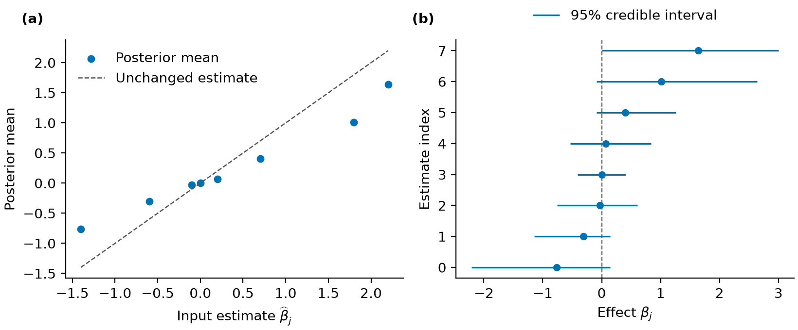

# Overview

AShrink provides empirical Bayes shrinkage for effect estimates, Poisson rates,
binomial probabilities, effects across conditions, and regression coefficients.
It estimates finite-mixture weights and returns posterior summaries. Fitting and
prediction use NumPy and SciPy; R is not a runtime dependency.

Choose a method from the input available for the analysis. Summary-input methods
start with effect estimates, counts or successes. Regression methods start with
outcomes and a numeric predictor matrix. The likelihood and prior determine the
parameter scale; a Poisson rate and a regression log-rate coefficient are different
parameters.

| Input | Function | Result |
| --- | --- | --- |
| Scalar estimates and standard errors | `fit` | `ASHResult` |
| Counts and exposure times | `fit_poisson` | `CountResult` |
| Successes and trial counts | `fit_binomial` | `CountResult` |
| Effect vectors and error covariances | `fit_multivariate` | `MultivariateResult` |
| Continuous outcomes and predictors | `fit_regression` | `RegressionResult` |
| Binary/binomial outcomes and predictors | `fit_logistic_regression` | `GLMResult` |
| Counts and predictors | `fit_poisson_regression` | `GLMResult` |
| Grouped continuous outcomes and predictors | `fit_mixed_regression` | `MixedRegressionResult` |

Posterior summaries condition on the fitted mixture weights and component grid.
Regression uses an independent-factor variational approximation. Credible intervals
and null/sign probabilities therefore require the qualifications given below.

# Installation

From GitHub, with Git installed:

```sh
python -m pip install 'git+https://github.com/nilson01/ashrink.git'
```

From a local checkout:

```sh
python -m pip install .
```

For plotting and pandas tables:

```sh
python -m pip install '.[plot,table]'
```

R is not a runtime dependency.

## Tested environments

The installed wheel passes 116 tests on macOS with Python 3.10.22
(NumPy 1.24.4, SciPy 1.11.4) and Python 3.14.3
(NumPy 2.5.4, SciPy 1.18.1).

[CI run 40295672151](https://github.com/nilson01/ashrink/actions/runs/40295672151)
also passes all 116 tests, with no failures, errors or skips, for commit
`a36b512` on Linux with Python 3.10.22 and 3.14.8, and on Windows Server 2025
with Python 3.13.16. The Linux Python 3.10 run uses NumPy 1.24.4,
SciPy 1.11.4 and Matplotlib 3.7.5 to check the minimum supported dependencies.

# Worked examples

## Gaussian effect estimates

```python
from ashrink import fit

result = fit(
    [-1.4, -0.6, -0.1, 0.0, 0.2, 0.7, 1.8, 2.2],
    [0.7, 0.4, 0.5, 0.3, 0.5, 0.4, 0.8, 0.7],
    scales=[0.2, 0.6, 1.5],
)
print(result.format_summary())
intervals = result.interval(level=0.95)
```

The two input vectors contain estimates and their standard errors. The normal-prior
component standard deviations are fixed at the supplied `scales`; their weights are
estimated. The first three posterior means are
`[-0.764278, -0.306851, -0.032956]`.

{width=95%}

## Student-t and asymmetric priors

```python
student = fit(
    [-1.4, -0.6, -0.1], [0.7, 0.4, 0.5],
    family="uniform", scales=[0.5, 2.0], df=8,
)
asymmetric = fit(
    [-1.4, -0.6, -0.1, 0.0, 0.2, 0.7, 1.8, 2.2],
    [0.7, 0.4, 0.5, 0.3, 0.5, 0.4, 0.8, 0.7],
    family="halfuniform", scales=[0.5, 2.0],
)
```

A finite `df` selects the Student-t likelihood. Its second vector gives scale
parameters, which are not Student-t standard deviations. `halfuniform` fits separate
negative and positive uniform components. Inspect sign probabilities carefully;
the prior grid and null-weight penalty affect their interpretation.

## Poisson rates and binomial probabilities

```python
from ashrink import fit_poisson, fit_binomial

rates = fit_poisson(
    [0, 1, 3, 8, 12], exposure=[1.0, 1.0, 2.0, 2.0, 3.0]
)
probabilities = fit_binomial([0, 2, 5, 8, 10], trials=10)
print(rates.summary())
print(probabilities.interval())
```

The Poisson posterior describes rates per exposure unit. The binomial posterior
describes success probabilities. Both use conjugate mixtures sharing the specified
mode. Their sign probabilities compare the parameter with `null_value`, rather than zero by default.

## Effects across conditions

```python
import numpy as np
from ashrink import fit_multivariate

effects = np.array([-1.4, -0.6, -0.1, 0.0])
paired = np.column_stack([effects, effects * 0.7])
multivariate = fit_multivariate(
    paired, np.full_like(paired, 0.5),
    covariances=[np.eye(2), np.ones((2, 2))],
    scales=[0.5, 1.5],
)
print(multivariate.format_summary())
```

Rows identify effects and columns identify conditions. The supplied covariance
patterns describe independent effects and effects shared across both conditions.
The fit estimates their mixture weights. It does not learn new covariance patterns.

## Binary, count and grouped regression

```python
from ashrink import (
    fit_logistic_regression, fit_poisson_regression,
    fit_mixed_regression,
)

X = np.array([[-1.0], [-0.5], [0.0], [0.5], [1.0], [1.5]])
binary = fit_logistic_regression(
    X, [0, 0, 1, 0, 1, 1], scales=[0.5, 1.0]
)
counts = fit_poisson_regression(
    X, [0, 1, 1, 2, 3, 4], exposure=1, scales=[0.5, 1.0]
)
grouped = fit_mixed_regression(
    X, [-1.0, 0.2, 1.0, 0.0, 1.2, 2.0],
    ["a"] * 3 + ["b"] * 3, scales=[0.5, 1.0],
)
print(binary.format_summary())
print(counts.format_summary())
print(grouped.random_effect_summary())
```

Logistic coefficients are on the log-odds scale; Poisson coefficients are on the
log-rate scale. The grouped Gaussian model adds a random intercept for each group.
These fixed examples demonstrate calls, not prediction accuracy or calibration.

# Posterior summaries and data handling

## Select a prior and likelihood

In `fit`, `family` selects the prior: `normal`, `uniform` or `halfuniform`.
A finite `df` selects a Student-t likelihood; its input standard-error value
is the distribution's **scale**, not its standard deviation. Gaussian inputs
use the usual standard error. `null_weight=1` fits mixture weights by maximum
likelihood; larger values add a penalty favouring the point-null component.

`normal_mixture` and `uniform_mixture` construct explicit scalar priors.
Pass one through `fit(..., prior=prior, fix_prior=True)` to evaluate a fixed
prior without estimating new weights. Summary-input results provide `shrink`
to evaluate new observations with the fitted prior, without estimating new
weights. Student-t results require the new observations' `df`. For count
results, `shrink(observations, auxiliary)` takes exposure times or trial counts
as its second argument.

When observations are counts, shrinkage must respect the parameter range.
Poisson rates are nonnegative and binomial probabilities lie between zero and
one. The Poisson and binomial methods therefore use Gamma and Beta mixtures with a
specified common mode. Their parameter and null scales differ from scalar
signed effects. These are conjugate-mixture extensions, not matched R ashr
likelihoods.

When effects are measured across conditions, their relationships can inform
shrinkage. Multivariate fitting uses supplied positive-semidefinite
covariance patterns and positive-definite observation-error covariances;
patterns and residual correlations are not learned from the effects.

For regression inputs, see Regression models. Its coefficient
distributions use a variational approximation; prediction returns outcome means.

## Inspect posterior results

All results provide `posterior_mean`, `posterior_sd`, `summary`, `cdf`,
`quantile`, `interval` and `sample`. `summary` returns reporting columns.
Scalar, multivariate and regression results also have `format_summary` for
compact text.
`sample` draws latent parameters, not future observed data.

`interval(level=.95)` returns equal-tailed posterior credible intervals.
They condition on the fitted mixture weights and selected component grid.
`lfdr` is posterior point-null probability. `lfsr` is the smaller posterior
probability of a nonpositive or nonnegative effect, including a zero atom in
both error events. For count models, the directions are relative to the
specified null rate or probability. `qvalue` and `svalue` average local null
and sign-error probabilities at their respective cutoffs. They are posterior
summaries, not automatic frequentist error-control guarantees. If the prior has
no atom at the reported parameter's null value, `lfdr` and `qvalue` are zero by
construction. This is a prior choice, not evidence against the null. In a
multivariate model, a coordinate can retain an atom even without a whole-vector
null component.

Multivariate results also provide posterior covariance matrices and the
probability that the whole effect vector is zero. A coordinate can have a
zero atom even when another coordinate does not. Marginal and whole-vector
null probabilities therefore have different meanings.

## Tables and saved results

Named-column adapters are `fit_frame`, `fit_poisson_frame`,
`fit_binomial_frame`, `fit_multivariate_frame` and the regression `_frame`
adapters. They accept pandas frames or mappings of columns.
Scalar missing values are rejected by default;
`missing="drop"` explicitly removes incomplete rows and retains their indices.
Other fitting methods require complete data.

`to_records` returns plain rows; `write_csv` exports summaries.
`save_result` and `load_result` use versioned JSON without pickle or code
execution. Summary-input results reconstruct their posterior calculations;
regression results restore their saved factors. Neither operation estimates new
mixture weights. Saved results retain input estimates or counts. Regression
JSON also retains training outcomes, directly or through fitted values and
residuals; it is not an anonymized summary. `result.to_dataframe()` requires
the `table` extra.

## Plots

For summary-input fits, `plot_shrinkage`, `plot_intervals`, `plot_prior` and
`plot_diagnostics` return
Matplotlib axes. They do not call `show` or save files. For multivariate
results, `condition` selects the column to display. Prior density plots keep
point-null probability separate from continuous density. Regression has
`plot_coefficients` and `plot_residuals`; `plot_diagnostics` displays the
variational objective. Random-intercept fits also have `plot_random_effects`.

# Regression models

Use `fit_regression` when the observations and predictors are available directly.
Conditional on the fitted intercept and predictor transformation, coefficient
fitting uses the Gaussian likelihood and prior

$$
\mathbf y\mid\mathbf X,\mathbf b,\sigma^2
\sim N(\mathbf X\mathbf b,\sigma^2 I_n),\qquad
b_j\mid g,\sigma^2
\sim\sum_{k=1}^{K}\pi_k N(0,\sigma^2\sigma_k^2).
$$

Here, $n$ is the number of observations, $p$ the number of predictors,
and $I_n$ the identity matrix. The $K$ mixture weights satisfy
$\pi_k\ge0$ and $\sum_k\pi_k=1$. The vector $\mathbf y$ contains
centered outcomes and $\mathbf X$ contains
centered, optionally scaled predictor columns. The vector $\mathbf b$ contains
coefficients on that predictor scale, and $\sigma^2$ is the residual variance.
With `fit_intercept=False`, outcomes and predictors are not centered.
The regression prior $g$ has mixture weights $\pi_k$, which describe how often each prior scale occurs.
A component with $\sigma_k=0$ is a point mass at zero. The method follows
[Kim et al. (2024), Sections 3.1-3.5 and Appendix E](https://jmlr.org/papers/v25/22-0953.html).

## Fit and predict

```python
import numpy as np
from ashrink import fit_regression

X = np.array([[-1., -1.], [-1., 1.], [1., -1.], [1., 1.]])
y = np.array([-1.8, -0.1, 0.6, 3.3])
result = fit_regression(X, y, scales=[0.3, 1.0], labels=["x1", "x2"])
print(result.format_summary())
predicted = result.predict(np.array([[0.2, 0.5], [0.8, -0.3]]))
```

`scales` supplies the relative prior standard deviations $\sigma_k$.
Fitting adds a zero atom by default and learns the mixture weights and residual
variance. The component grid is sorted and deduplicated; `initial_weights`
must follow the resulting order, with the zero atom first.

The default fit includes an intercept and divides centered predictor columns
by their root mean square. Returned coefficients and their intervals use the
original predictor units. `predict` accepts numeric columns in the fitted order
and reuses the fitted transformation. It returns outcome means, without
prediction intervals. More predictors than observations are allowed; missing
values and predictors with no information are rejected.

For named columns, use `fit_regression_frame(data, outcome, predictors)`.
For an aligned numerical comparison, disable standardization or reproduce its
transformation explicitly. Fixed mixture weights and residual variance are
available through `estimate_weights=False` and
`estimate_residual_variance=False`, with their respective `initial_*` values.

## Coefficients and diagnostics

`coefficients`, `intercept`, `residual_variance` and `weights` report fitted
quantities. `interval`, `cdf`, `quantile` and `sample` describe approximate
marginal coefficient distributions. `summary` returns numeric columns;
`plot_coefficients`, `plot_residuals` and `plot_diagnostics` inspect the fit.
Saved JSON includes fitted values and residuals, from which training outcomes
can be recovered. It is not an anonymized summary.

The algorithm uses independent coefficient factors and maximizes an evidence
lower bound (ELBO). Inspect `diagnostics["converged"]` and the recorded ELBO
history. Convergence is local and can depend on initialization. The default
starts coefficients at zero; `initial_coefficients` supplies another start.

Intervals condition on fitted mixture weights, residual variance and intercept.
They do not include uncertainty from estimating those quantities. With strongly
correlated predictors, the approximation can favor one predictor over another
and understate uncertainty. Null/sign probabilities do not provide guaranteed
variable selection or establish causal effects. The Gaussian method requires a
dense numeric predictor matrix. Binary, count and grouped outcomes use the
separate methods below.

## Binary and count outcomes

| Outcome | Function | Prediction |
| --- | --- | --- |
| Binary outcomes or successes/trials | `fit_logistic_regression(X, y, trials=1)` | Probability; supply new `trials` for expected successes |
| Counts with exposure times | `fit_poisson_regression(X, y, exposure=1)` | Expected counts at new `exposure` |

Both functions accept a numeric `offset` on the link scale. New predictions
use exposure one and offset zero unless specified. Training row values are
never reused for new rows. `predict(..., scale="link")` returns the linear
predictor. Predictions apply the inverse link to mean coefficients; they do
not integrate coefficient uncertainty. Poisson exponential underflow and
overflow raise an error; link predictions can still represent extreme values.

Unlike Gaussian regression, these priors use absolute coefficient standard
deviations on the transformed predictor scale. No residual variance is fitted.
Logistic coefficients describe log odds; Poisson coefficients describe log rates.
Their intervals remain approximate marginal credible intervals.

Logistic fitting uses the quadratic lower bound of
[Jaakkola and Jordan (1997)](https://proceedings.mlr.press/r1/jaakkola97a.html).
Poisson fitting evaluates its expected log likelihood using the exponential
moments of the mixture-normal factors. It then optimizes component means and
variances with safeguarded Newton steps. Both methods estimate mixture weights
and report their variational objective. These are extensions beyond the scalar
ASH likelihoods, rather than matched R `ashr` methods.

## Grouped continuous outcomes

`fit_mixed_regression(X, y, groups)` adds independent Gaussian random intercepts
to Gaussian regression. Supply one nonempty string group label per observation.
The fit estimates a common group variance as well as the residual variance.
The `estimate_group_variance` and `estimate_residual_variance` flags can hold
supplied initial values fixed.

`result.predict(X_new)` returns population means. Supplying known group labels
adds their fitted random intercepts. Unseen labels raise an error unless
`allow_new_groups=True`, which assigns those groups a mean random effect of zero.
Neither choice adds future observation noise or integrates uncertainty in the
group effects.

`random_effect_summary` and `random_effect_interval` report the approximate
group distributions; `plot_random_effects` displays them. Fixed and group
factors are independent in the variational approximation. Their marginal
variances need not equal those from an exact joint Gaussian analysis.
Random slopes, general correlation structures and non-Gaussian mixed models
are outside this version.

The worked examples show all three methods. Named-column adapters add `_frame`
to each fitting function's name.
`fit_mixed_regression_frame` takes the group column through `group=`.

# Numerical methods and interpretation

The scalar implementation estimates finite-mixture weights for the
adaptive-shrinkage models described by [Stephens (2017)](https://doi.org/10.1093/biostatistics/kxw041).
Gaussian component posteriors are analytic. Student-t component posteriors
use adaptive one-dimensional quadrature and record integration diagnostics.
Quadrature can be substantially slower than the analytic Gaussian calculation.

Mixture fitting uses expectation-maximization (EM) with fixed component grids,
followed by constrained optimization when the optimality residual remains
large. Diagnostics retain the objective history, iteration count, stopping
rule and a Karush-Kuhn-Tucker (KKT) optimality residual. A small residual is a
numerical stopping criterion; it does not establish
statistical calibration or uniqueness of the fitted prior. Results retain
nonconvergence information rather than treating every returned fit as reliable.

The R reference version is ashr 2.2-63. Uniform widths and normal standard
deviations have different meanings. Student-t inputs are scale parameters.
The normal-prior/Student-t combination uses an independent integration method;
the inspected R implementation rejects that combination. Ranked summaries
include all tied local probabilities at a cutoff, which can differ from R's
order-dependent cumulative averages within ties.

Count models use conjugate Gamma-Poisson and Beta-binomial mixtures sharing
a specified mode, with an optional point mass at that mode. Multivariate
models use finite mixtures of zero-mean normals with supplied covariance
patterns, following the fixed-pattern part of
[Urbut et al. (2019)](https://doi.org/10.1038/s41588-018-0268-8).
AShrink does not implement all methods in ashr or mashr.

Posterior probabilities and credible intervals condition on estimated mixture
weights. They omit uncertainty from fitting those weights. Dependence between
scalar observations, misspecified likelihoods and unsuitable prior components
can affect inference. The numerical reference checks below describe the
comparisons and their limits.

Gaussian regression uses cyclic variational coordinate ascent with
residual-variance-scaled normal-mixture priors, following
[Kim et al. (2024)](https://jmlr.org/papers/v25/22-0953.html).
The objective is an evidence lower bound, rather than the exact marginal
likelihood. Coefficient marginals factorize; their variances need not equal
those from the exact joint posterior. Mean predictions reuse fitted
preprocessing. See Regression models for inputs and limits.

Binary/binomial regression uses a quadratic logistic lower bound. Poisson
regression uses analytic exponential moments of independent mixture-normal
factors, with guarded inner Newton optimization. Gaussian random-intercept
regression uses independent coefficient and group factors. These extensions
have focused analytic and stationarity checks, not repeated-dataset calibration
studies. Prediction applies the fitted mean coefficients; nonlinear predictions
do not integrate their uncertainty. See Regression models.

# Numerical reference checks


The test fixtures contain six scalar cases from installed R `ashr` 2.2-63
and five Gaussian regression cases from installed `mr.ash.alpha` 0.1-43
(commit `8e257fdb73589f280192b1c99a176d82196be298`).
Three multivariate cases also use installed `mashr` 0.2.79. All exports used
R 4.5.1. Archive and exporter hashes are stored with each fixture.

| Comparison | Quantities | Absolute and relative tolerance |
| --- | --- | --- |
| Gaussian scalar, fixed prior | Mean, SD, null/sign probabilities, weights | `2e-11` |
| Student-t/uniform scalar, fixed prior | Same quantities | `2e-7` |
| Gaussian scalar, estimated weights | Same quantities | `2e-6` |
| Gaussian regression, converged fit | Coefficients, intercept, residual variance, weights | `1e-5` |
| Gaussian regression, one sweep | Same quantities | `2e-10` |
| Multivariate, fixed prior or one component | Means, SDs, covariance, null/sign probabilities, weights | `2e-10` |
| Multivariate, estimated mixture | Same quantities | `5e-6` |

Regression comparisons use explicit grids, zero initial coefficients, common
initial weights/variance, an intercept and no standardization. R uses
`method_q="sigma_indep_q"`, matching the fixed-factor variance update.
Its `sigma_dep_q` option uses a different update and need not agree after one
sweep. Stopping rules also differ: AShrink checks changes in the evidence
lower bound (ELBO), whereas R checks coefficient or mixture-weight changes.
Matching results in these cases does not establish global optimization, interval
coverage or prediction performance.

R warns that half-uniform priors without a null-biased penalty can give
misleading sign probabilities. Those fixed-prior cases check arithmetic only.
The regression reference also warns when substantial weight reaches the largest
prior component. The comparison keeps the explicit grid unchanged; an applied
analysis should inspect its adequacy.

Conjugate count models and fixed-pattern multivariate models have independent
analytic tests. Their inclusion does not imply full `ashr` or `mashr` coverage.
Logistic and Poisson-regression tests check null-only likelihoods and the
stationarity equations for a single normal factor. Random-intercept tests
compare fixed-variance posterior means with a joint Gaussian block solution.
These checks address the implemented updates; they do not establish interval
coverage or prediction performance across repeated datasets.

Multivariate comparisons use explicit covariance patterns, correlation matrices,
unit scale multipliers and no automatic covariance normalization. One case
checks a single full-rank component, one estimates mixture weights, and one
reconstructs fixed-weight summaries with singular patterns and a zero atom.
The fixed-weight case uses `mash(..., fixg=TRUE)` in R and public result
reconstruction in Python. It checks posterior calculations rather than fitting
new mixture weights. R's one-component optimizer reports that no optimization
is needed. Learning covariance patterns is not supported.


# Function reference

Required arguments have no default in the signatures below. Arguments with a
default can be omitted. An input may still be required by another choice; for
example, an explicit covariance matrix is an alternative to standard errors in
multivariate fitting. All names below are imported from `ashrink`.

## Scalar and count models


### `fit`

```python
fit(
    effects,
    standard_errors,
    *,
    family='normal',
    df=None,
    scales=None,
    point_mass=True,
    null_weight=1,
    prior=None,
    fix_prior=False,
    maxiter=10000,
    tol=1e-08,
    missing='raise',
    labels=None,
)
```

Fit a zero-mode scalar mixture prior and obtain posterior summaries.

`family` chooses the prior: normal, uniform, or halfuniform. Errors are
Gaussian unless positive finite `df` requests a Student-t likelihood;
standard_errors is then the Student-t scale, not its standard deviation.
Infinite df selects Gaussian errors. Finite and infinite df may be mixed.
Supplied scales are normal SDs or uniform half-widths. The default grid
follows ashr 2.2-63's geometric rule, with spacing sqrt(2).

`null_weight >= 1` adds (null_weight - 1) log(pi0) to the objective.
A supplied prior supplies the grid and starting weights; fix_prior=True
also fixes those weights. Missing rows are rejected unless missing='drop'.
Neither intervals nor local error probabilities account for uncertainty
in estimated mixture weights. Student-t quadrature is slower than the
analytic Gaussian path; inspect diagnostics for integration accuracy.


### `normal_mixture`

```python
normal_mixture(scales, weights=None, point_mass=True)
```

Construct zero-mean normal components, optionally with a zero atom.

`scales` contains standard deviations. Duplicates are removed and the
resulting grid is sorted. Supplied weights refer to that final grid,
including its leading zero atom when requested.


### `uniform_mixture`

```python
uniform_mixture(widths, weights=None, asymmetric=False, point_mass=True)
```

Construct symmetric or separate left/right uniform components.

Positive widths a produce [-a,a], or [-a,0] followed by [0,a] when
asymmetric=True. Within each side widths are sorted. A requested zero
atom comes first; supplied weights refer to this final component order.


### `fit_poisson`

```python
fit_poisson(
    counts,
    exposure=1,
    *,
    null_value=1,
    strengths=None,
    point_mass=True,
    null_weight=1,
    maxiter=10000,
    tol=1e-08,
)
```

Shrink Poisson rates under a fitted mode-shared gamma mixture.

Counts follow a Poisson distribution with mean `exposure[i] * rate[i]`. Continuous Gamma components have shape `1 + null_value * strength`
and rate `strength`. The default grid is
`2**arange(-4, 9)`. `null_weight-1` is a nonnegative null-atom
pseudo-count, not an observation weight. No missing values are accepted.


### `fit_binomial`

```python
fit_binomial(
    successes,
    trials,
    *,
    null_value=0.5,
    strengths=None,
    point_mass=True,
    null_weight=1,
    maxiter=10000,
    tol=1e-08,
)
```

Shrink binomial probabilities under a fitted mode-shared beta mixture.

Beta components have parameters `1 + null_value * strength` and
`1 + (1 - null_value) * strength`.
The default grid is `2**arange(-4, 9)`. Trials may be scalar; zero trials
are allowed only with zero successes and contribute no likelihood evidence.
`null_weight-1` penalizes the null atom as a nonnegative pseudo-count.

## Multivariate models


### `fit_multivariate`

```python
fit_multivariate(
    effects,
    standard_errors=None,
    *,
    error_covariance=None,
    correlation=None,
    covariances=None,
    scales=None,
    point_mass=True,
    null_weight=1,
    maxiter=10000,
    tol=1e-08,
)
```

Fit a finite mixture of fixed multivariate normal covariance patterns.


**Parameters**


- **`effects`** (array, shape (n,d)).
  Finite effect estimates; d must be at least two. Rows are independent.

- **`standard_errors`** (array, shape (n,d)).
  Positive standard errors. Used with a supplied residual correlation
  matrix or the identity. Alternatively supply `error_covariance`.

- **`error_covariance`** (array, shape (d,d) or (n,d,d)).
  Positive definite observation-error covariance. Cannot be combined
  with standard errors or a correlation matrix.

- **`correlation`** (array, shape (d,d)).
  Positive definite residual correlation, treated as known.

- **`covariances`** (array, shape (k,d,d)).
  Positive semidefinite prior patterns; singular patterns are allowed.
  Defaults to identity, equal-effect and single-condition patterns.

- **`scales`** (nonnegative vector).
  Standard-deviation multipliers: components are scale**2 times each
  pattern. With supplied patterns the default is [1]. Canonical patterns
  use [0.1,0.25,0.5,1,2,4] times the median standard error.

- **`point_mass`** (bool).
  Include one all-zero component. Zero components supplied through the
  grid are retained even when False; duplicates are removed exactly.

- **`null_weight`** (float >= 1).
  Dirichlet parameter for the joint null; 1 gives maximum likelihood.
  A value above one requires a joint-null component.

- **`maxiter, tol`** (int, float).
  Total EM/SLSQP iteration limit and weight-change warmup tolerance.
  Final convergence uses the relative KKT residual with threshold
  max(1e-7, 10*tol); inspect diagnostics.

**Notes**

Mixture weights are estimated on all supplied rows. Do not select only
significant rows before learning the prior. Posterior summaries condition
on the fitted weights, patterns and error covariance. No covariance-pattern
learning or missing-condition imputation is performed. PSD eigenvalues at
most 1e-12 times their largest absolute eigenvalue are treated as roundoff.

## Regression models


### `fit_regression`

```python
fit_regression(
    X,
    y,
    *,
    scales=None,
    point_mass=True,
    fit_intercept=True,
    standardize=True,
    estimate_weights=True,
    estimate_residual_variance=True,
    initial_coefficients=None,
    initial_weights=None,
    initial_residual_variance=None,
    maxiter=1000,
    tol=1e-06,
    labels=None,
)
```

Fit Gaussian multiple regression with a normal-mixture shrinkage prior.

For transformed predictors, y = X b + error with error variance sigma^2,
and b_j has prior sum_k pi_k N(0, sigma^2 * scales[k]^2). A scale of zero
denotes a point mass at zero. Supplied `scales` are standard deviations
relative to the residual SD, not component variances. The default uses
scales 2**(0.05*k)-1 for k=0,...,19, following mr.ash's 20-point grid.
Duplicate scales are removed and the grid is sorted. Initial weights refer
to this final order, including the leading zero atom when requested.

`X` is a finite dense (n,p) array and `y` has length n. Standardization
divides each centered column by its root mean square (divisor n). With no
intercept, columns and y are not centered. Coefficients, intervals and
`initial_coefficients` use original predictor units. Columns with zero
information after centering are rejected; the intercept is fitted separately.

Each sweep updates coefficient factors, then mixture weights and residual
variance while holding those factors fixed (Kim et al., 2024, Appendix E).
Set either `estimate_*` flag to False to retain its initial value.
The residual-variance update divides its expected quadratic terms by n plus
the sum of posterior probabilities of nonzero coefficients. This is the
fixed-factor update of Kim et al. (2024), Appendix E.3. ELBO convergence is a
local stopping criterion, not
evidence of a global optimum or calibrated variable selection.


### `fit_logistic_regression`

```python
fit_logistic_regression(
    X,
    y,
    *,
    trials=1,
    offset=0,
    scales=None,
    point_mass=True,
    fit_intercept=True,
    standardize=True,
    estimate_weights=True,
    initial_coefficients=None,
    initial_weights=None,
    initial_intercept=None,
    maxiter=1000,
    tol=1e-06,
    labels=None,
)
```

Fit binomial logistic regression with adaptive normal-mixture priors.

`y` contains successes and `trials` contains totals; binary outcomes use
trials one. The prior scales are absolute coefficient SDs after predictor
transformation, with no Gaussian residual-variance factor. Scales are
sorted and deduplicated; initial weights refer to that final grid, including
a leading zero atom when requested. Defaults are 0.25, 0.5, 1, 2 and 4.
Initial coefficients use original predictor units; initial_intercept is the
intercept for the transformed design. Returned intercepts use original units.

Zero-trial rows remain in the result but do not determine predictor centering
or scaling. Inputs are finite dense arrays; missing values are rejected.
An unpenalized intercept requires at least one success and one failure.
Fitting maximizes a Jaakkola--Jordan lower bound using independent
coefficient factors. Its intervals are approximate marginal credible
intervals, conditional on fitted weights and intercept.


### `fit_poisson_regression`

```python
fit_poisson_regression(
    X,
    y,
    *,
    exposure=1,
    offset=0,
    scales=None,
    point_mass=True,
    fit_intercept=True,
    standardize=True,
    estimate_weights=True,
    initial_coefficients=None,
    initial_weights=None,
    initial_intercept=None,
    maxiter=1000,
    tol=1e-06,
    inner_maxiter=100,
    inner_tol=1e-08,
    labels=None,
)
```

Fit Poisson log-link regression with adaptive normal-mixture priors.

Expected counts are exposure * exp(intercept + offset + X b). Exposures
must be positive. Prior scales are absolute SDs on transformed coefficients;
no Gaussian residual variance is fitted. Scales are sorted and deduplicated,
and initial weights use that order with a leading zero atom when requested.
Initial coefficients use original predictor units; initial_intercept is the
intercept for the transformed design. Returned intercepts use original units.

The algorithm uses the exact expected Poisson log likelihood within the
independent mixture-normal approximation. Positive-component means and
variances are optimized by damped Newton steps. Failed inner optimization
and nonfinite exponential moments raise an error. Coefficient intervals
remain approximate, conditional on fitted weights and intercept.


### `fit_mixed_regression`

```python
fit_mixed_regression(
    X,
    y,
    groups,
    *,
    scales=None,
    point_mass=True,
    fit_intercept=True,
    standardize=True,
    estimate_weights=True,
    estimate_residual_variance=True,
    estimate_group_variance=True,
    initial_weights=None,
    initial_residual_variance=None,
    initial_group_variance=None,
    initial_coefficients=None,
    maxiter=1000,
    tol=1e-06,
    labels=None,
)
```

Fit Gaussian regression with shrunk coefficients and random intercepts.

y_i = alpha + x_i b + u_groups[i] + error_i, with independent
u_g ~ N(0,tau^2) and errors ~ N(0,sigma^2). On transformed predictors,
b_j follows sum_k pi_k N(0,sigma^2*scales[k]^2), including a zero atom
when requested. Group labels must be nonempty strings; convert numeric
identifiers to strings before fitting. No random slopes or GLMM is fitted.

Coordinate ascent uses independent coefficient and group variational
factors. Each estimate_* flag can fix its supplied starting parameter.
The intercept is unpenalized; centering and RMS scaling match fit_regression.
The default grid is 2**(0.05*k)-1 for k=0,...,19. Initial coefficients
and returned coefficient summaries use original predictor units.

## Named-column inputs


### `fit_frame`

```python
fit_frame(
    data,
    estimate='estimate',
    standard_error='se',
    *,
    label=None,
    df=None,
    **options,
)
```

Fit scalar effects from a pandas DataFrame or mapping of columns.

`df` may name a column of Student-t degrees of freedom or supply numeric
degrees of freedom. A label column is retained for result tables.


### `fit_poisson_frame`

```python
fit_poisson_frame(data, count='count', exposure='exposure', **options)
```

Fit Poisson rates from named count and exposure columns.


### `fit_binomial_frame`

```python
fit_binomial_frame(data, successes='successes', trials='trials', **options)
```

Fit binomial probabilities from named success and trial columns.


### `fit_multivariate_frame`

```python
fit_multivariate_frame(data, estimates, standard_errors, **options)
```

Fit effect/SE matrices assembled from matching named columns.


### `fit_regression_frame`

```python
fit_regression_frame(data, outcome, predictors, **options)
```

Fit Gaussian regression from an outcome and named numeric predictors.


### `fit_logistic_regression_frame`

```python
fit_logistic_regression_frame(
    data,
    outcome,
    predictors,
    *,
    trials=1,
    offset=0,
    **options,
)
```

Fit logistic regression; trials and offset may name numeric columns.


### `fit_poisson_regression_frame`

```python
fit_poisson_regression_frame(
    data,
    outcome,
    predictors,
    *,
    exposure=1,
    offset=0,
    **options,
)
```

Fit Poisson regression; exposure and offset may name numeric columns.


### `fit_mixed_regression_frame`

```python
fit_mixed_regression_frame(data, outcome, predictors, *, group, **options)
```

Fit Gaussian random intercepts from a named string group column.

## Tables and saved results


### `read_csv`

```python
read_csv(path)
```

Read a headered numeric CSV into a mapping of NumPy columns.


### `to_records`

```python
to_records(result, *, level=0.95)
```

Return one plain record per observation and condition.

Bounds are equal-tailed empirical-Bayes posterior credible intervals,
conditional on the fitted mixture weights.


### `write_csv`

```python
write_csv(result, path, *, level=0.95, overwrite=False)
```

Write posterior summaries to a headered CSV file.


### `save_result`

```python
save_result(result, path, *, overwrite=False)
```

Save a versioned JSON result; no executable objects are stored.

A new file is required unless `overwrite=True`. Serialization finishes
before the destination is opened.


### `load_result`

```python
load_result(path)
```

Restore posterior calculations from a JSON result without refitting.

## Plots


### `plot_shrinkage`

```python
plot_shrinkage(result, *, condition=0, ax=None)
```

Compare input estimates with posterior means on the same scale.

Binomial rows with zero trials have no observed proportion and are omitted
from this display; they remain in the fitted result.


### `plot_intervals`

```python
plot_intervals(result, *, condition=0, level=0.95, indices=None, ax=None)
```

Show equal-tailed posterior credible intervals and posterior means.

Each horizontal line represents a retained observation. The interval
conditions on fitted mixture weights; it is not a frequentist confidence
interval or an interval for a future observation.


### `plot_prior`

```python
plot_prior(result, values=None, *, condition=0, ax=None)
```

Display continuous prior density; show point-null mass separately.

An atom is a probability, not a density height. Its mass is labelled in
the legend rather than drawn as an infinite density spike.


### `plot_diagnostics`

```python
plot_diagnostics(result, *, ax=None)
```

Display the recorded optimization objective by optimization iteration.


### `plot_coefficients`

```python
plot_coefficients(result, *, level=0.95, indices=None, ax=None)
```

Show approximate marginal regression intervals on the coefficient scale.

These variational intervals condition on fitted hyperparameters; they do not
include uncertainty in the intercept or residual variance.


### `plot_residuals`

```python
plot_residuals(result, *, ax=None)
```

Plot observed residuals against fitted response means.


### `plot_random_effects`

```python
plot_random_effects(result, *, level=0.95, ax=None)
```

Display approximate Gaussian random-intercept marginal intervals.

# Result classes

Obtain results from fitting functions or `load_result`; constructing the internal
posterior arrays directly is unnecessary for an analysis. The shared methods below
operate on latent parameters. They do not generate future outcomes.

| Method | Meaning |
| --- | --- |
| `cdf(value)` | Posterior probability at or below `value` |
| `quantile(probability)` | Marginal posterior quantile; probabilities lie in [0, 1] |
| `interval(level=0.95)` | Equal-tailed marginal credible interval |
| `sample(size=1, seed=None)` | Reproducible draws of latent effects or coefficients |
| `summary(level=0.95)` | Numeric reporting columns |
| `to_dataframe(level=0.95)` | pandas table; requires the table extra |
| `to_dict()` / `from_dict(value)` | Portable result representation and reconstruction |

## `MixturePrior`

A fixed component grid and its mixture probabilities.

Use `normal_mixture` or `uniform_mixture` to construct a grid.
All components have mode zero; asymmetric uniform components may have
different weights on either side of zero.

```python
with_weights(weights)
```

Return a prior with the same components and the supplied normalized weights.

```python
density(x)
```

Continuous density only; `null_mass` gives the zero atom.

```python
cdf(x)
```

Right-continuous CDF, including the zero atom.

```python
to_dict()
```

```python
from_dict(value)
```

```python
to_json()
```

```python
from_json(text)
```

## `ASHResult`

Scalar mixture posterior summaries conditional on a fitted prior.

`lfdr` is the posterior zero-atom probability. `lfsr` is the smaller posterior
probability of a nonpositive or nonnegative effect, so the atom belongs to
both error events. Strict negative/positive probabilities exclude it.
Credible intervals condition on estimated weights, not uncertainty in
those weights. Missing rows are absent and `row_indices` maps back to
the original input. Public numeric arrays are read-only.

```python
prior_density(x)
```

```python
prior_cdf(x)
```

```python
cdf(value)
```

Posterior probability of an effect at or below `value`; supply one threshold
or one threshold per row.

```python
quantile(probability)
```

Quantiles: scalar -> (n,), levels vector -> (levels, n).

```python
interval(level=0.95)
```

Equal-tailed posterior interval, conditional on the fitted prior.

```python
sample(size=1, seed=None)
```

Draw (size, n) posterior samples, conditional on the fitted prior.

```python
summary(level=0.95)
```

Numeric reporting columns, without a pandas dependency.

```python
format_summary(level=0.95, digits=6)
```

A compact text summary with at most twelve rows.

```python
to_dataframe(level=0.95)
```

Return summary columns; requires the optional pandas dependency.

```python
shrink(effects, standard_errors, df=None, *, missing='raise', labels=None)
```

Apply the fitted prior to new observations without estimating weights.

Student-t fits require degrees of freedom for the new observations;
degrees of freedom attached to old rows are not silently reused.

```python
to_dict()
```

JSON-compatible inputs, fitted prior and diagnostics (schema 1).

```python
from_dict(value)
```

Rebuild component posteriors from stored inputs without fitting weights.

```python
save(path)
```

Save a versioned JSON result, without pickle or executable objects.

```python
load(path)
```

## `CountResult`

Fitted conjugate mixture and marginal posterior summaries.

`probability_below_null` and `probability_above_null` are strict tail
probabilities. `lfsr` includes equality in both directional error events.
`qvalue` averages null probabilities at each tied null-probability cutoff;
`svalue` does the same for lfsr. These are posterior summaries, not claims
of frequentist error control.

```python
shrink(observations, auxiliary=1)
```

Evaluate new observations using the fitted prior without refitting.

`auxiliary` gives exposure for a Poisson result or trials for a
binomial result. It may be scalar or one value per observation. Supply
the appropriate new exposure times or trial counts explicitly when
they differ from one. The original grid, null and mixture weights are
reused; the original observations are not added to the new likelihood.

```python
cdf(value)
```

Return the posterior probability of a rate or probability at or below `value`;
supply one threshold or one threshold per row.

```python
quantile(prob)
```

Posterior generalized inverse CDF; levels by observations for 1D input.

```python
interval(level=0.95)
```

Equal-tail posterior credible intervals, one row per observation.

```python
sample(size=1, seed=None)
```

Draw posterior samples; result shape is (size, observations).

```python
prior_density(value)
```

Continuous prior density; the null atom is excluded.

```python
prior_cdf(value)
```

Prior CDF, including the null atom.

```python
summary(level=0.95)
```

Return numeric columns for reporting; no pandas dependency.

```python
to_dataframe(level=0.95)
```

Return summary columns as a pandas DataFrame (requires pandas).

```python
to_dict()
```

```python
from_dict(data)
```

Restore a stored mixture without optimizing weights again.

```python
save(path)
```

```python
load(path)
```

## `MultivariateResult`

Posterior summaries for fixed-pattern multivariate shrinkage.

`lfdr` is the marginal probability of an exactly zero effect, which may
include condition-specific atoms. `joint_null_probability` refers only
to the component whose whole effect vector is zero. Fitted-prior summaries
do not integrate uncertainty in the estimated mixture proportions.

```python
cdf(value)
```

Marginal posterior probability at or below `value`, including zero atoms.

```python
prior_density(value, *, condition=0)
```

Continuous marginal fitted-prior density, excluding zero atoms.

`value` can have any shape. `condition` selects a matrix column.
The excluded probability is `prior_null_probability[condition]`.

```python
prior_cdf(value, *, condition=0)
```

Marginal fitted-prior CDF for one condition, including zero atoms.

```python
shrink(new_effects, standard_errors=None, *, error_covariance=None, correlation=None)
```

Evaluate new independent rows using the exact fitted prior.

New rows do not update covariance patterns or mixture weights.
Supply their standard errors or error covariances explicitly.

```python
quantile(probability)
```

Marginal generalized-inverse CDF, not a simultaneous region.

A scalar returns (n,d); a one-dimensional probability vector returns
(levels,n,d). Endpoints are infinite for unbounded marginals.

```python
interval(level=0.95)
```

Equal-tailed marginal credible intervals, with shape (n,d,2).

```python
sample(size=1, seed=None)
```

Draw conditional posterior samples with shape (size,n,d).

```python
summary(level=0.95)
```

Return numeric (n,d) reporting columns without requiring pandas.

```python
format_summary()
```

Return a short human-readable description of the result.

```python
to_dataframe(level=0.95)
```

Return a long table; install the separate `table` extra for pandas.

```python
to_dict()
```

Return JSON-compatible inputs and fitted weights; no executable data.

```python
from_dict(value)
```

Reconstruct summaries with fixed weights, without optimization.

## `RegressionResult`

Variational coefficient distributions for Gaussian regression.

Coefficients and their component distributions use the original predictor
units. `scales` instead describes the prior on the transformed design:
component k has variance `residual_variance * scales[k]**2`. Intercept
estimation and hyperparameter uncertainty are not included in the marginal
coefficient intervals. Correlated predictors can have underestimated joint
uncertainty under the factorized approximation.

```python
predict(X)
```

Predict the outcome mean for a finite (n_new,p) numeric matrix.

The fitted centering and scaling are already incorporated in the
original-unit coefficients and intercept. No prediction interval or
extra observation noise is included.

```python
cdf(value)
```

Approximate marginal coefficient probability at or below `value`, including
zero atoms.

```python
quantile(probability)
```

Approximate marginal quantiles; scalar gives (p,), vector gives (levels,p).

```python
interval(level=0.95)
```

Equal-tailed approximate marginal credible intervals, shape (p,2).

```python
sample(size=1, seed=None)
```

Draw (size,p) coefficients independently from variational factors.

```python
summary(level=0.95)
```

Return coefficient reporting columns; all uncertainty is approximate.

```python
format_summary(level=0.95, digits=4)
```

Return a compact coefficient table and the optimizer status.

```python
to_dataframe(level=0.95)
```

Return coefficient summaries; requires the separate `table` extra.

```python
to_dict()
```

Return versioned variational factors and prediction transformations.

Training fitted values and residuals are included. Saving this result
therefore retains information about training outcomes.

```python
from_dict(document)
```

Restore saved factors without fitting or recomputing the posterior.

```python
save(path, *, overwrite=False)
```

Save JSON using the shared persistence interface.

```python
load(path)
```

Load a Gaussian regression result using the shared JSON reader.

## `GLMResult`

Approximate coefficients and plug-in predictions for a fitted GLM.

Logistic coefficients are log odds per predictor unit; Poisson coefficients
are log rates per predictor unit. Coefficient intervals condition on fitted
mixture weights and the estimated intercept. They exclude hyperparameter
and intercept uncertainty. Predictions apply the inverse link to the mean
coefficients; they do not integrate the coefficient distributions.

```python
cdf(value)
```

```python
quantile(probability)
```

```python
interval(level=0.95)
```

Approximate marginal coefficient credible intervals, shape (p,2).

```python
sample(size=1, seed=None)
```

Independent variational coefficient draws, shape (size,p).

```python
predict(X, *, scale='response', trials=None, exposure=1, offset=0)
```

Predict using mean coefficients and new-row offsets.

`scale='link'` returns log odds or log expected counts. On the
response scale logistic output is a probability unless `trials` is
supplied, when it is expected successes. Poisson output is expected
counts at the supplied exposure. New rows default to exposure one and
offset zero; training offsets are never reused.

```python
summary(level=0.95)
```

Return approximate coefficient distributions on the link scale.

```python
format_summary(level=0.95, digits=4)
```

```python
to_dataframe(level=0.95)
```

Return coefficient summaries; requires the `table` extra.

```python
to_dict()
```

Serialize factors and training responses without refitting.

```python
from_dict(document)
```

```python
save(path, *, overwrite=False)
```

```python
load(path)
```

## `MixedRegressionResult`

Fitted fixed-effect factors and Gaussian group-intercept factors.

Fixed-effect summaries and coefficient distribution methods follow
`RegressionResult`; the methods below add group-specific outputs and predictions.
Fixed effects use original predictor units. All intervals are approximate
marginal credible intervals conditional on fitted hyperparameters. They
exclude intercept uncertainty and covariance between coefficient factors.
Group identifiers are case-sensitive nonempty strings.

```python
predict(X, groups=None, *, allow_new_groups=False)
```

Predict population means, or conditional means for supplied groups.

With groups=None, no group effect is added. Unknown group labels raise
unless allow_new_groups=True, which assigns their prior mean zero.
Neither choice adds observation noise or supplies prediction intervals.

```python
random_effect_interval(level=0.95)
```

Approximate marginal group-intercept intervals, shape (n_groups,2).

```python
random_effect_summary(level=0.95)
```

```python
random_effect_intervals(level=0.95)
```

Alias for random_effect_interval, with one interval per fitted group.

```python
summary(level=0.95)
```

Return fixed-effect reporting columns; group summaries are separate.

```python
format_summary(level=0.95, digits=4)
```

```python
to_dict()
```

Serialize fitted factors, including training outcomes via residuals.

```python
from_dict(document)
```

Restore stored factors without optimization or executable objects.

```python
save(path, *, overwrite=False)
```

```python
load(path)
```

# References and attribution

- Stephens, M. (2017). False discovery rates: a new deal. *Biostatistics*, 18,
  275-294. [DOI](https://doi.org/10.1093/biostatistics/kxw041).
- Urbut, S. M., Wang, G., Carbonetto, P., and Stephens, M. (2019). Flexible
  statistical methods for estimating and testing effects in genomic studies with
  multiple conditions. *Nature Genetics*, 51, 187-195.
  [DOI](https://doi.org/10.1038/s41588-018-0268-8).
- Kim, Y., Wang, W., Carbonetto, P., and Stephens, M. (2024). A flexible empirical
  Bayes approach to multiple linear regression and connections with penalized
  regression. *Journal of Machine Learning Research*, 25(185), 1-59.
  [Article](https://jmlr.org/papers/v25/22-0953.html).
- Jaakkola, T. S., and Jordan, M. I. (1997). A variational approach to Bayesian
  logistic regression models and their extensions. *Proceedings of the Sixth
  International Workshop on Artificial Intelligence and Statistics*, 283-294.
  [Article](https://proceedings.mlr.press/r1/jaakkola97a.html).

AShrink is an independent Python implementation. The R packages `ashr`, `mashr`
and `mr.ash.alpha` provide matched numerical references where specified; their
authors have not endorsed AShrink. See the repository's NOTICE and LICENSE for
software attribution and license terms.
